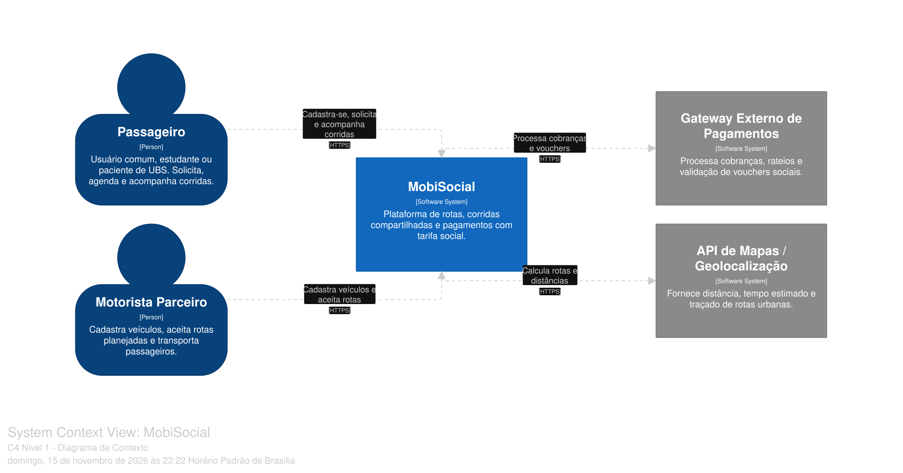
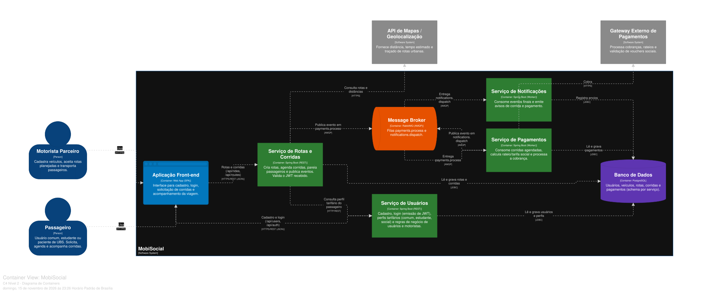

# MobiSocial: Transporte e Mobilidade Urbana Inclusiva

Criação de Rotas, Agendamento de Corridas, Compartilhamento de Veículos e Gestão de Pagamentos e Tarifas Sociais documentado com C4 Model (Structurizr).

## 1. Definição do Produto e Escopo

### 1.1. Visão Geral do Produto
O **MobiSocial** é uma plataforma de transporte e mobilidade urbana voltada para a criação de rotas inteligentes, agendamento de corridas individuais ou compartilhadas (*carpooling*), gerenciamento de passageiros e motoristas e processamento de pagamentos (incluindo rateio automático de tarifas e subsídios sociais para estudantes e pacientes em deslocamento para Unidades Básicas de Saúde e hospitais). O sistema é construído sob uma **Arquitetura Orientada a Serviços (SOA)** integrada de forma assíncrona por uma **Arquitetura Baseada em Eventos (Event-Driven)** com Spring Boot e RabbitMQ.

#### Problemas Reais Solucionados
- **Otimização e Compartilhamento de Veículos (*Carpooling*):** Reduz o custo individual de deslocamento e o congestionamento urbano ao agrupar passageiros com origens, paradas e destinos compatíveis na mesma rota planejada, aproveitando a capacidade ociosa dos veículos.
- **Acesso à Educação e Saúde (Tarifa Social e Rotas Prioritárias):** Conecta estudantes universitários e pacientes de UBS/hospitais a rotas acessíveis, permitindo pagamentos simplificados com rateio solidário, PIX/cartão ou aplicação automática de desconto de tarifa social.
- **Processamento Assíncrono em Horários de Pico:** Em horários de alta demanda, o agendamento de corridas, o cálculo de divisão tarifária e o disparo de notificações ocorrem de forma desacoplada via mensageria, evitando gargalos e lentidão para passageiros e motoristas.

### 1.2. Catálogo de Atores e Sistemas Externos
Abaixo estão definidos os atores e os sistemas externos que interagem diretamente com o **MobiSocial**, servindo de base para o **Diagrama de Contexto (C4 Nível 1)**:

#### Atores (*Persons*)
| Ator | Perfil / Papel | Principais Interações com o Sistema |
|:-----|:---------------|:------------------------------------|
| **Passageiro** | Cidadão comum, Estudante ou Paciente de UBS. | Consulta rotas disponíveis, agenda corridas individuais ou compartilhadas, realiza pagamentos com rateio/tarifa social e recebe notificações da viagem. |
| **Motorista Parceiro** | Condutor credenciado ou motorista de frota urbana. | Cadastra veículo e capacidade de assentos, cria ou aceita rotas urbanas planejadas e visualiza a lista de passageiros embarcados. |

#### Sistemas Externos (*External Systems*)
| Sistema Externo | Tipo | Principais Interações com o Sistema |
|:----------------|:-----|:------------------------------------|
| **Gateway Externo de Pagamentos** | Sistema Externo (API REST / HTTPS) | Processa a cobrança eletrônica das corridas (PIX, cartão de crédito ou validação de voucher estudantil/social). |
| **Serviço Externo de Mapas e Geolocalização** | Sistema Externo (API REST / HTTPS) | Fornece cálculo de distância em quilômetros, estimativa de tempo de percurso e validação de paradas da rota urbana. |
| **Serviço Externo de Mensageria / Push** | Sistema Externo (E-mail / SMS / Push API) | Realiza a entrega das notificações de confirmação de agendamento, alocação de motorista e recibo de pagamento aos usuários. |

### 1.3. Funcionalidades Documentadas (Requisitos Funcionais)

| Requisito | Funcionalidade | Descrição |
|:----------|:---------------|:----------|
| **RF01** | **Gerenciar usuários e veículos** | Cadastrar passageiros (identificando perfil comum, estudante ou tarifa social de saúde) e motoristas com seus respectivos veículos e capacidade máxima de assentos. |
| **RF02** | **Criar e consultar rotas urbanas** | Permitir a criação de rotas contendo ponto de partida, paradas intermediárias, destino final, horário de saída e assentos disponíveis. |
| **RF03** | **Agendar corridas e compartilhar veículos** | Receber solicitações de viagem via API REST, parear o passageiro com uma rota compatível respeitando o limite de assentos e confirmar a reserva compartilhada. |
| **RF04** | **Processar pagamentos e rateio de tarifa** | Calcular o valor final da viagem aplicando a divisão de custos entre passageiros da mesma rota ou descontos de tarifa social e processar a transação financeira via evento assíncrono. |
| **RF05** | **Notificar status de corridas e pagamentos** | Emitir avisos assíncronos ao passageiro e ao motorista sempre que uma corrida for agendada, a lotação do veículo for atualizada ou o pagamento for confirmado. |

### 1.4. Resumo do Fluxo Principal

1. O passageiro solicita o agendamento de uma corrida compartilhada enviando uma requisição HTTP (`POST /api/rides`) com origem, destino, rota desejada e modalidade de pagamento.
2. O **Serviço de Rotas e Corridas** valida a disponibilidade de assentos na rota selecionada, atualiza a ocupação do veículo no banco de dados PostgreSQL e registra o agendamento com status `AGUARDANDO_PAGAMENTO`.
3. Em seguida, o serviço publica um evento de corrida agendada na fila `payments.process` do RabbitMQ, liberando imediatamente a resposta HTTP para o usuário.
4. O **Serviço de Pagamentos** consome o evento da fila `payments.process`, aplica a regra de rateio entre os passageiros (ou desconto de tarifa social), comunica-se com o Gateway de Pagamentos e salva a transação aprovada no PostgreSQL.
5. Após aprovar a cobrança, o Serviço de Pagamentos publica um evento de confirmação na fila `notifications.dispatch` do RabbitMQ.
6. O **Serviço de Notificações** consome o evento de confirmação e dispara o aviso final de viagem confirmada e recibo tarifário para o passageiro e para o motorista.

## 2. Estilos Arquiteturais Selecionados

Para atender aos requisitos do **Tema 13 (Aplicativo de Transporte e Mobilidade Urbana)**, o projeto combina dois estilos arquiteturais:

### 2.1. Arquitetura Orientada a Serviços (SOA — Service-Oriented Architecture)
- **Aplicação no Sistema:** O back-end em **Spring Boot** é decomposto em três serviços modulares orientados a capacidades de negócio independentes:
  * **Serviço de Rotas e Corridas (`RideService`):** Responsável pelo cadastro de trajetos, controle de capacidade dos veículos e agendamento de corridas compartilhadas via API REST (`RideController`, `RideService`, `RouteRepository`, `RideRepository`).
  * **Serviço de Pagamentos e Tarifas (`PaymentService`):** Responsável pelo cálculo de divisão tarifária (*carpooling*), aplicação de subsídio social e integração financeira (`PaymentEventListener`, `PaymentService`, `PaymentRepository`).
  * **Serviço de Notificações (`NotificationService`):** Responsável pela formatação e envio de alertas de status de viagem e confirmação de embarque (`NotificationEventListener`, `NotificationService`).
- **Justificativa Arquitetural:** A abordagem **SOA** permite separar claramente as regras de mobilidade urbana (rotas e lotação) das regras financeiras (pagamentos e vouchers) e de comunicação, garantindo baixo acoplamento, alta coesão e facilidade de manutenção por duplas em paralelo.

### 2.2. Arquitetura Baseada em Eventos (Event-Driven Architecture)
- **Aplicação no Sistema:** A comunicação entre os serviços SOA após a solicitação da corrida ocorre de forma totalmente assíncrona por meio do **RabbitMQ** (protocolo `AMQP`), utilizando as filas `payments.process` e `notifications.dispatch`.
- **Justificativa Arquitetural:** Em horários de pico no trânsito urbano, centenas de solicitações de agendamento e rateio ocorrem simultaneamente. O estilo orientado a eventos garante **desacoplamento temporal**: o Serviço de Rotas e Corridas confirma a reserva do assento rapidamente via HTTP e delega o processamento financeiro e o envio de avisos para processamento assíncrono em background, aumentando a resiliência e a escalabilidade do sistema.

## 3. Documentação Arquitetural (Modelo C4 - Structurizr)

O código-fonte da modelagem arquitetural encontra-se em [`/docs/c4/workspace.dsl`](./docs/c4/). As Decisões Arquiteturais (ADRs) estão documentadas em [`/docs/adr/`](./docs/adr/) e o guia de contribuição em [`/docs/CONTRIBUTING.md`](./docs/CONTRIBUTING.md).

### 3.1. C4 Nível 1: Diagrama de Contexto


### 3.2. C4 Nível 2: Diagrama de Container


## 4. Guia Passo a Passo de Execução do Projeto

> *Nota: Os comandos abaixo descrevem o procedimento completo de execução da implementação parcial do fluxo principal em Spring Boot.*

### Pré-requisitos
- **Docker** e **Docker Compose**
- **Java JDK 17+** e **Maven**
- **Postman**, **Insomnia** ou **cURL** (para disparar requisições HTTP aos endpoints REST)

### 4.1. Subir a Infraestrutura (RabbitMQ e PostgreSQL)
Na raiz do repositório, inicie os containers do Message Broker e do Banco de Dados via Docker Compose:
```bash
docker compose up -d
```
- **RabbitMQ (AMQP):** `localhost:5672` | **Painel Web:** `http://localhost:15672`
- **PostgreSQL:** `localhost:5432`

### 4.2. Executar a Aplicação Spring Boot
Na raiz do repositório, inicie os serviços do MobiSocial utilizando o Maven Wrapper:
```bash
./mvnw spring-boot:run
```

### 4.3. Testar o Fluxo Principal (Agendamento + Evento de Pagamento + Notificação)
Com a aplicação rodando na porta `8080`, envie uma requisição `POST` pelo Postman ou via terminal (`curl`) para agendar uma corrida compartilhada e acionar a cadeia de eventos no RabbitMQ:
```bash
curl -X POST http://localhost:8080/api/rides \
  -H "Content-Type: application/json" \
  -d '{
    "passengerId": 1,
    "routeId": 10,
    "sharedRide": true,
    "tariffType": "ESTUDANTE",
    "paymentMethod": "PIX"
  }'
```

## 5. Cronograma e Divisão de Atividades da Equipe

**Integrantes (Equipe 10):** Felipe Maia, João Vitor, Maria José, Cauan Ricardo, Clidenor e Pablo.

| Etapa | Prazo Oficial | Dupla Responsável | Entregável Principal | Foco Técnico da Frente |
| :--- | :--- | :--- | :--- | :--- |
| **Etapa 1** | 16/11 | **Dupla A:** Felipe Maia e Clidenor | Repositório GitHub e Estilos | Criar repo, adicionar equipe, estruturar pastas (`/docs/c4`, `/docs/adr`, `/src`), justificar SOA + Event-Driven no `README.md`, guia de execução e importar dependências do Spring Boot. |
| **Etapa 1** | 16/11 | **Dupla B:** Pablo e Maria | Escopo MobiSocial e Requisitos | Documentar o problema de Mobilidade Urbana, atores, funcionalidades (RF01-RF05) e fluxo principal no `README.md`. |
| **Etapa 1** | 16/11 | **Dupla C:** Cauan Ricardo e João Vitor | Diagramas C4 Níveis 1 e 2 | Configurar Structurizr DSL (`workspace.dsl`) e gerar os diagramas de Contexto e Container alinhados ao `README.md`. |
| **Etapa 2** | 23/11 | **Dupla A:** Felipe Maia e Clidenor | C4 Nível 3 (Pagamentos/Eventos) | Modelar os componentes internos do Serviço de Pagamentos, filas do RabbitMQ (`payments.process` e `notifications.dispatch`) e Serviço de Notificações. |
| **Etapa 2** | 23/11 | **Dupla B:** Pablo e Maria | C4 Nível 3 (Rotas e Corridas) | Modelar os componentes internos do Serviço de Rotas e Corridas (`RideController`, `RideService`, `RouteMatchingComponent`, `RideRepository`). |
| **Etapa 2** | 23/11 | **Dupla C:** Cauan Ricardo e João Vitor | C4 Nível 4 (Código) e ADRs | Modelar o diagrama de classes do fluxo de agendamento/rateio e redigir as Decisões Arquiteturais (ADRs 01, 02 e 03) em `/docs/adr`. |
| **Etapa 3** | 01/12 | **Dupla A:** Felipe Maia e Clidenor | Infra Docker e Pagamentos | Subir Docker Compose (RabbitMQ + PostgreSQL), configurar filas AMQP no Spring Boot e implementar o Serviço de Pagamentos (`PaymentEventListener` e `PaymentService`). |
| **Etapa 3** | 01/12 | **Dupla B:** Pablo e Maria | Serviço de Rotas e Corridas | Implementar o endpoint REST (`POST /api/rides`), lógica de alocação em rota compartilhada e publicação de evento no RabbitMQ em conformidade com os níveis 3 e 4. |
| **Etapa 3** | 01/12 | **Dupla C:** Cauan Ricardo e João Vitor | Notificações, Conformidade e Slides | Implementar consumidor de notificações (`NotificationEventListener`), auditar conformidade código x Structurizr e preparar apresentação. |